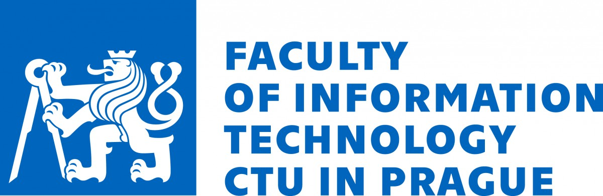

# 📈 Agentic LLM for Time Series

> **⚠️ Notice: Under Active Development**  
> This project is currently in the early stages of development as part of a Diploma thesis. The architecture, codebase, and features are undergoing frequent changes. Expect breaking changes and experimental features.

## 📖 About the Project

A Diploma thesis project focused on building a local, agentic Large Language Model (LLM) system dedicated to time series analysis and predictions.

The core philosophy of this project is to bridge the gap between complex mathematical modeling and user-friendly interaction. By utilizing an AI agent, users can explore and forecast their data through natural conversation without needing to write code or understand the underlying statistics.

## ✨ Key Features

- 💬 **Conversational AI:** Utilizes a local LLM for the frontend conversational interface, understanding user intent and orchestrating the analysis.
- 📊 **Advanced Analytics:** Employs advanced Python time series libraries for accurate data prediction, processing, and explanation.
- 🔒 **Clear & Local:** Designed to be run entirely on your own hardware, ensuring maximum privacy and data security.
- 💡 **Free & Open-Source:** Accessible to everyone without paywalls, commercial cloud API dependencies, or hidden costs.

## 🎓 Acknowledgments

This software was developed with the support of the Faculty of Information Technology at the Czech Technical University in Prague, fit.cvut.cz

